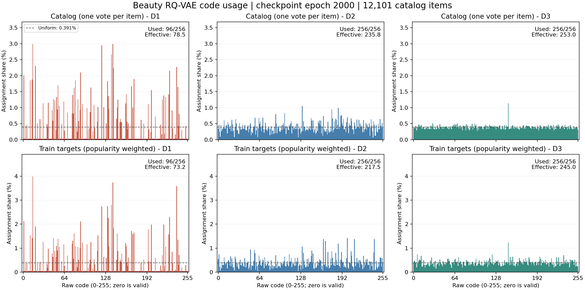

# Beauty 当前 Codebook 使用诊断（2026-10-20）

**第一层存在明显码字闲置/部分使用坍缩，第二层有一定频次偏斜，第三层整体接近均匀。**

## 数据与口径

- 当前实际用于TIGER/CoTIGER的三位SID，共12101个商品；每层256个码字，原始ID为0～255，原始0是合法码字。
- SID与原云端导出及RQ-VAE第2000 epoch快照逐项一致，输入SHA256保存在summary.json。这里的epoch均指RQ-VAE，不是TIGER的100 epoch。
- 主统计按商品计数，每个商品一票；另按131413条Train目标交互加权，后者会额外反映商品流行度。
- 完全离线CPU统计，未加载模型、重新量化、训练或使用Validation/Test标签调整模型。

## 按商品统计（诊断码本利用率的主口径）

| 层 | 活跃码字 | 使用率 | 未用码字 | 熵（满值8bit） | 有效码字数（满值256） | 最高单码占比 | Top10码字占比 |
| --- | ---: | ---: | ---: | ---: | ---: | ---: | ---: |
| D1 | 96 | 37.50% | 160 | 6.2938 | 78.45 | 2.99% | 24.68% |
| D2 | 256 | 100.00% | 0 | 7.8815 | 235.81 | 1.05% | 8.26% |
| D3 | 256 | 100.00% | 0 | 7.9829 | 252.98 | 1.14% | 5.56% |

有效码字数=2^H，其中H=-sum(p*log2(p))。均匀使用m个码字时有效数为m；它同时反映活跃数和频次均衡程度。完美均匀基准：单码0.390625%、Top10码3.90625%、每码约47.27件商品。

- 第一层只覆盖96个码字，160个未命中；有效数78.45，主要问题是大面积闲置，并非所有商品只挤到一两个码字。活跃码字中每码20～362件商品。
- 第二层无未用码字，有效数235.81；每码8～127件商品，仍有一定不均衡。
- 第三层无未用码字，有效数252.98；每码33～138件商品，整体接近均匀，但code147仍是热点（1.14%），不能称严格均匀。

## 训练目标交互加权

| 层 | 活跃码字 | 有效码字数 | 最高单码占比 | Top10码字占比 |
| --- | ---: | ---: | ---: | ---: |
| D1 | 96 | 73.24 | 3.99% | 28.43% |
| D2 | 256 | 217.46 | 1.42% | 11.87% |
| D3 | 256 | 244.98 | 1.24% | 7.23% |

交互加权后更偏斜，这包含用户行为/商品流行度效应，不应全部解释为RQ-VAE坍缩。

## 训练快照

| RQ-VAE epoch | D1活跃/有效数 | D2活跃/有效数 | D3活跃/有效数 |
| --- | ---: | ---: | ---: |
| 200 | 17 / 14.34 | 47 / 31.45 | 239 / 172.18 |
| 400 | 84 / 66.78 | 101 / 83.12 | 241 / 208.80 |
| 600 | 96 / 78.99 | 146 / 126.66 | 244 / 217.68 |
| 800 | 96 / 79.49 | 249 / 229.56 | 256 / 248.34 |
| 1000 | 96 / 78.48 | 255 / 235.47 | 256 / 251.91 |
| 1200 | 96 / 78.94 | 255 / 235.46 | 256 / 249.80 |
| 1400 | 96 / 78.79 | 255 / 233.54 | 256 / 251.66 |
| 1600 | 96 / 78.79 | 256 / 235.34 | 256 / 252.24 |
| 1800 | 96 / 78.83 | 256 / 236.18 | 256 / 252.47 |
| 2000 | 96 / 78.45 | 256 / 235.81 | 256 / 252.98 |

第一层第600～2000 epoch始终只有96个活跃码字；本轮只能确认这种利用不足持续存在，不能据此认定更长训练、重启死码或修改损失一定有效。

## 几何与碰撞核查

- 三层各有256个数值不同的32维向量，中心化矩阵秩均为32。因此没有出现全部码字向量完全相同或整体降到低秩的情况；这不能排除局部近重复，也不能消除第一层使用坍缩。
- 完整SID有11401种，525个碰撞组，1225件商品处于碰撞组（10.12%），最大组21件。不同层分别均匀不保证组合SID无碰撞，不能把全部碰撞单独归因于第一层。
- 本报告中的“未用/死码”只表示当前完整商品目录eval分配未命中，不等于已证明训练时永远没有梯度。
- 当前仓库RQ-VAE配置为前两层STE、末层Sinkhorn；源码训练分支为Sinkhorn指定均匀列边际，而导出的SID使用eval最近邻argmin。该设置与末层较均衡的现象相符，本轮没有进行因果消融。

## 图与结果

- 上排：商品目录；下排：Train目标交互；虚线为256码完全均匀的0.391%。
- 统计与全部未用码字ID：`out/tiger_prefix_ft/beauty_codebook_usage_20261020/summary.json`。
- 每码频次：同目录`code_counts.csv`；训练快照：`checkpoint_usage.csv`。
- 复现脚本：`tiger_prefix_ft/analyze_codebook_usage.py`（运行前选择不存在的新输出路径，保留既有结果）。
